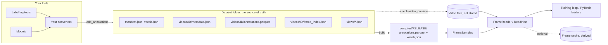

# Architecture

How the pieces fit together: what is stored, what is code, what is derived, and where each responsibility lives. For why it was built
this way see [design decisions](design-decisions.md); for the exact file contents see the [specification](SPEC.md).

## The big picture

Three kinds of thing, kept apart on purpose:

| kind | examples | rule |
|---|---|---|
| **the dataset** (source of truth) | manifest, vocab, metadata, annotation tables, frame indexes, views | plain JSON and Parquet; shareable by copying the folder |
| **derived** (can be rebuilt) | releases under `compiled/`, the frame cache, previews | never needed to understand the dataset; safe to delete |
| **external** | the video files | never copied into the dataset; found by path hint, recognised by content hash |

## The two packages

| package | contains | depends on |
|---|---|---|
| `vidlabel-spec` | pydantic models (`VideoMetadata`, `View`, `Region`, `FrameIndex`, `Vocab`, `Manifest`, `Release`), `SPEC_VERSION`, the JSON Schema | pydantic only |
| `vidlabel` | everything that reads and writes data, plus the CLI | the spec package, NumPy, PyArrow, zstandard, Typer; optionally OpenCV and PyTorch |

The split lets another program (or language) read the format from the schema without installing the library.

## Modules of `vidlabel`

| module | responsibility |
|---|---|
| `dataset.py` | `Dataset`: create/open, videos, labels, views, `add_annotations`, filtered reads, review (`update_*`, `delete_*`, tracks), `derive_view_rows`, stats. The only code that writes annotation files, atomically (temp file + rename) |
| `validate.py` | every check in the [validation table](validation.md); used on writes and by `vidlabel validate`; `Issue`, `ValidationError` |
| `_arrow.py` | the Arrow schema of the annotation table and the Parquet writing settings (zstd, row groups, statistics) |
| `masks.py` | the `bitpack_zstd` codec and helpers (encode, decode, crop-only decode, resize, COCO RLE conversion) |
| `boxes.py` | conversions between `xyxy`, `xywh`, `cxcywh`; rotation of boxes |
| `build.py` | `build()` and `Compiled`: sorted release tables with row-group statistics for fast clips |
| `samples.py` | `FrameSamples`: turn a release or the live table into per-frame training targets; columnar, with a sorted `(video, frame)` index |
| `readplan.py` | `ReadPlan`/`Chunk`: pure planning of cheap reads for any frame list; no video or framework needed |
| `frames.py` | `FrameReader` (OpenCV), frame-index-aware seeking with a per-frame timestamp check, view cropping and resizing, `check_video` |
| `cache.py` | the optional frame cache (`FrameCache`, `CachedReader`) |
| `probe.py` | ffprobe wrappers: video facts, the frame index, content hash |
| `preview.py` | drawing annotations on frames: boxes, masks, markers, review status |
| `torch_data.py` | `VideoStream`, `VideoFrames`, `PlannedStream`, `collate_frames`, `to_tensors` |
| `cli.py` | the Typer app; each command wraps library calls, and errors become one `[error]` line |

## Data flow in detail

**Writing.** `add_annotations(rows, video_id)` normalises rows (encoding masks, filling boxes from masks, converting view
coordinates to full-frame), validates the batch and the rows already stored (for the track rules), and only then rewrites that
video's Parquet file atomically. Nothing is written if any row fails.

**Reading.** `annotations()` pushes filters into the Parquet read (row-group statistics and the page index make frame-range reads
cheap). It returns a PyArrow table; Python objects appear only if you ask (`to_pylist`).

**Building.** `build()` validates, concatenates every video's table, sorts by (`video_id`, `start_frame`, `annotation_id`), writes it with
row groups sized for pruning, hashes the file for the release id, and writes the vocabulary snapshot and `release.json`.

**Training.** `FrameSamples` keeps the selected rows as NumPy columns and a sorted index, so opening a million-annotation release takes
well under a second. A sample is built from a frame plus `targets()`. Reading frames goes through `FrameReader` (or the cache), which
uses the frame index to seek, checks each returned frame against it, and warns when the file's length differs from the metadata.
A `ReadPlan` arranges a list of reads by keyframe interval; `PlannedStream` splits chunks between workers and ranks.

## Concurrency and safety

- One writer per video at a time; there are no locks. Different videos never conflict, so a team can split work by video.
- Writes are atomic, so a crash leaves the old file, not a half-written one. A second writer to the same video can still overwrite
  the first one's changes.
- Ids from the outside (video and view ids) are restricted to a safe alphabet and cannot be `.` or `..`; see [security](security.md).

## Extension points

| you want | do this |
|---|---|
| custom data on rows, videos, labels, views | the `extra` field under your own key |
| a custom provenance | `origin: "x-yourthing"` and `tool` |
| another file format in or out | a converter on top of `add_annotations` and `annotations` ([guide](converters.md)); not part of the library by design |
| another mask codec | a new `MaskCodec` value and module ([development](development.md#other-changes)) |
| your own sampling policy | choose frames yourself and pass them to `plan_reads`; the library arranges the reading, not the choice |
